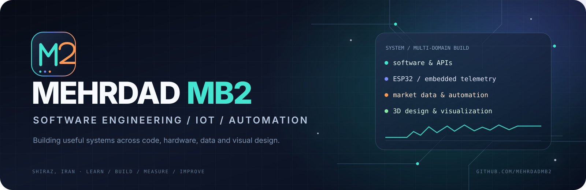
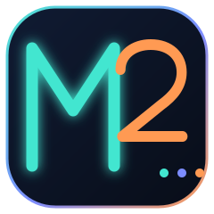
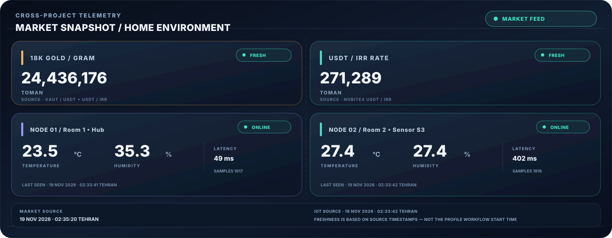
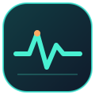
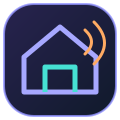
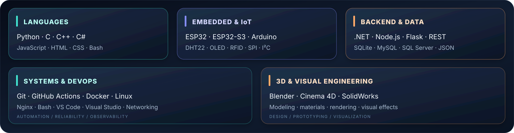
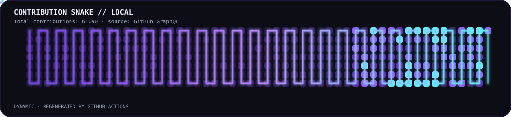
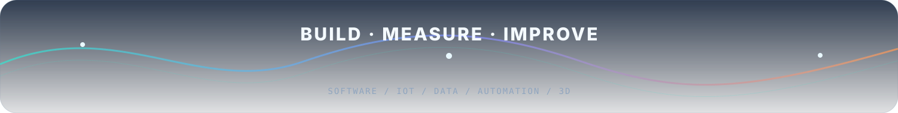

 

  

<b>⌘ Quick navigation</b>

 
<a href="#about">About</a> ·
<a href="#live-system">Live system</a> ·
<a href="#featured-projects">Projects</a> ·
<a href="#movie-shelf">Movie shelf</a> ·
<a href="#toolkit">Toolkit</a> ·
<a href="#github-analytics">GitHub analytics</a> ·
<a href="#contributions">Contributions</a> ·
<a href="#roadmap">Roadmap</a> ·
<a href="#support">Support</a> ·
<a href="#contact">Contact</a>

---

## `~/about $ whoami`

**Mehrdad** · `@mehrdadmb2` · Shiraz, Iran  
Computer Engineering — Software

I enjoy building things at the intersection of **software, hardware, data and visual design**. My work ranges from Python applications and developer utilities to ESP32-based IoT systems, market-data automation, responsive dashboards and 3D workflows.

I care about practical outcomes: reliable behaviour, clear interfaces, useful telemetry, maintainable code and graceful recovery when a network, API or device is unavailable.

**Current interests:** IoT and embedded systems · Python and automation · APIs and backend engineering · networking and Linux · desktop tooling · Blender, Cinema 4D and SolidWorks.

> Learn continuously. Build practical systems. Ship useful things.

---

## `~/observability $ ./profile --live`

A cross-project snapshot assembled from the public data published by my own repositories. The graphic is regenerated by GitHub Actions; it is not a browser-side animation or a hard-coded live feed.

  

  
  
  

**Data notes:** the profile refresh workflow checks the published feeds every 10 minutes. ArzPulse itself updates its market snapshot on its own schedule; PySmartHome publishes the latest telemetry snapshot. GitHub scheduled jobs can be delayed, so the graphic includes source timestamps and freshness states. A stale or unavailable source is labelled as such instead of being presented as current data. Gold and USDT values are displayed in toman; the source stores those values in rial.

**Open the source dashboards:** [ArzPulse market terminal](https://mehrdadmb2.github.io/ArzPulse/) · [PySmartHome control center](https://mehrdadmb2.github.io/PySmartHome-PC/) · [IMDb Showcase](https://mehrdadmb2.github.io/imdb-showcase/)

---

## `~/projects $ tree --featured`

<table>
  <tr>
    <td align="center" width="33%">
       
      <b><a href="https://github.com/mehrdadmb2/ArzPulse">ArzPulse</a></b> 
      Market intelligence · Telegram automation  
      
      
    </td>
    <td align="center" width="33%">
       
      <b><a href="https://github.com/mehrdadmb2/PySmartHome-PC">PySmartHome-PC</a></b> 
      ESP32 telemetry · Local-first IoT  
      
      
    </td>
    <td align="center" width="33%">
       
      <b><a href="https://github.com/mehrdadmb2/imdb-showcase">IMDb Showcase</a></b> 
      Personal film library · Poster archive  
      
      
    </td>
  </tr>
</table>

### A few more builds

| Project | What it does |
|---|---|
| [Mehrdad Dev](https://mehrdadmb2.github.io/mehrdad-dev/) | Interactive developer portfolio and project hub |
| [Dual Ping Monitor](https://github.com/mehrdadmb2/dual-ping-monitor) | Multi-target network availability and latency monitoring |
| [Peugeot 206 Garage](https://github.com/mehrdadmb2/peugeot-206-garage) | Vehicle maintenance, expenses, service history and Telegram workflow |
| [GitHub Profile Studio](https://github.com/mehrdadmb2/github-profile-studio) | Dynamic profile components, badges and visual profile tooling |
| [GitHub Page Insights](https://github.com/mehrdadmb2/github-page-insights) | Lightweight traffic and visit analytics for GitHub Pages |
| [SmartHome Hybrid IoT](https://github.com/mehrdadmb2/SmartHome-Hybrid-IoT) | ESP32 hub, sensor nodes and offline-safe home automation |

---

## `~/cinema $ ./shelf --top-rated`

A small, automatically refreshed window into my IMDb Showcase collection. Featured titles are selected from the repository's own movie dataset using personal ratings; posters are copied from its local poster cache, so the profile does not depend on hotlinking random poster sites.

<!-- FEATURED-MOVIES:START -->
> Movie posters will appear after the first successful run of **Featured Movie Posters** in the repository's Actions tab. The full library is available at [IMDb Showcase](https://mehrdadmb2.github.io/imdb-showcase/).
<!-- FEATURED-MOVIES:END -->

---

## `~/toolkit $ neofetch --engineering`

  
    
  

<b>Technology map</b>

 

| Area | Tools and technologies |
|---|---|
| **Languages** | Python · C · C++ · C# · JavaScript · HTML · CSS |
| **Embedded & IoT** | ESP32 · ESP32-S3 · Arduino · Raspberry Pi · DHT22 · OLED · RFID · SPI · I²C |
| **Backend & APIs** | .NET · Node.js · Flask · REST APIs · Nginx |
| **Data** | SQLite · MySQL · Microsoft SQL Server · JSON · CSV |
| **Systems & DevOps** | Git · GitHub Actions · Docker · Linux · Bash · Windows · networking |
| **3D & engineering** | Blender · Cinema 4D · SolidWorks · modeling · rendering · visual effects |

---

## `~/github $ ./metrics --overview`

  

<b>Language fingerprint</b>

<b>Contribution terrain</b>

<b>Coding habits and activity</b>

<b>Repositories and notable work</b>

<b>Achievements</b>

<a href="https://github.com/mehrdadmb2?tab=achievements">Open GitHub achievements ↗</a>

---

## `~/contributions $ ./snake --watch`

  <picture>
    <source media="(prefers-color-scheme: dark)" srcset="assets/snake-dark.svg">
    <source media="(prefers-color-scheme: light)" srcset="assets/snake.svg">
    
  </picture>

---

## `~/roadmap $ cat roadmap.yml`

| Now | Next |
|---|---|
| More reliable ESP32 communication and offline-first telemetry | Production-ready IoT platforms |
| Better API design, validation and observability | Reusable developer tools and services |
| More automation and testing across GitHub projects | Stronger documentation and release pipelines |
| Improve 3D design and visualization workflows | Independent software products |

---

## `~/support $ ./donate --safe`

Support helps fund hardware experiments, software projects, open-source tooling and future prototypes.

> **Network safety:** verify the blockchain, network and asset before sending. Never send an asset through a different network because an address format looks similar.

| Network | Asset | Address | QR |
|:---:|:---:|---|:---:|
| **TON** | TON / compatible token | `UQBQU9KnjwIsdSGwG08b3L43Vy_wPlCg_3FaK9m4N2Toj84k` |  |
| **TRON** | USDT / TRC20 | `TYbqxzEWrvYPnLvGtk6JY6Sbh8DMqfjcYq` |  |
| **Ethereum** | ETH / ERC20 | `0x968C2fD883a2004276f5e627Fe38654137601c51` |  |
| **Bitcoin** | BTC | `bc1q6knq0g4w9axt7t204y3e4hk4kz4zkh8vxj2e3a` |  |
| **Solana** | SOL / SPL | `7otC7qwCWqmrzbVA3XykjsZHbuKgrqaP2hE25NnByRDP` |  |
| **BNB Smart Chain** | BNB / BEP20 | `0x968C2fD883a2004276f5e627Fe38654137601c51` |  |
| **Polygon** | POL / compatible token | `0x968C2fD883a2004276f5e627Fe38654137601c51` |  |
| **TRON** | TRX / TRC20 | `TGYN1zzeGUjuXipVPvS4gTUivQyAu7GNUm` |  |

  
  

---

## `~/connect $ ./open-channel`

| Channel | Best for | Contact |
|---|---|---|
| **Email** | Private or detailed communication | [game.developer.mb@gmail.com](mailto:game.developer.mb@gmail.com) |
| **Telegram** | Quick messages and collaboration | [@IIMehrdadII](https://t.me/IIMehrdadII) |
| **GitHub** | Code, issues and pull requests | [@mehrdadmb2](https://github.com/mehrdadmb2) |
| **LinkedIn** | Professional networking | [Mehrdad MB](https://www.linkedin.com/in/mehrdad-mb-658520232) |
| **Instagram** | Visual and informal contact | [@_._.m._.b](https://instagram.com/_._.m._.b) |
| **X** | Public updates | [@__Mehrdad_](https://x.com/__Mehrdad_) |
| **Discord** | Community and real-time chat | [0mehrdad0](https://discord.gg/0mehrdad0) |

<b>Open the GitHub contact form</b>

For project ideas, technical questions, collaboration or open-source work, use the repository's structured [Contact / Collaboration Form](https://github.com/mehrdadmb2/mehrdadmb2/issues/new?template=contact.yml).

Do not include passwords, API keys, private tokens, authentication cookies, wallet seed phrases or other confidential information.

---

## `~/activity $ tail -n 6 latest.log`

<!-- BLOG-POST-LIST:START -->
- Activity feed is refreshed automatically by GitHub Actions.
<!-- BLOG-POST-LIST:END -->

---

  
  Profile visuals and cross-project telemetry are generated from public repository data · Last-mile freshness is shown in each data panel.

